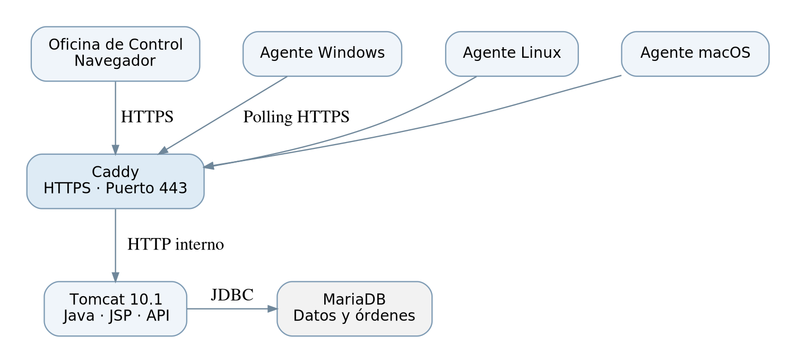
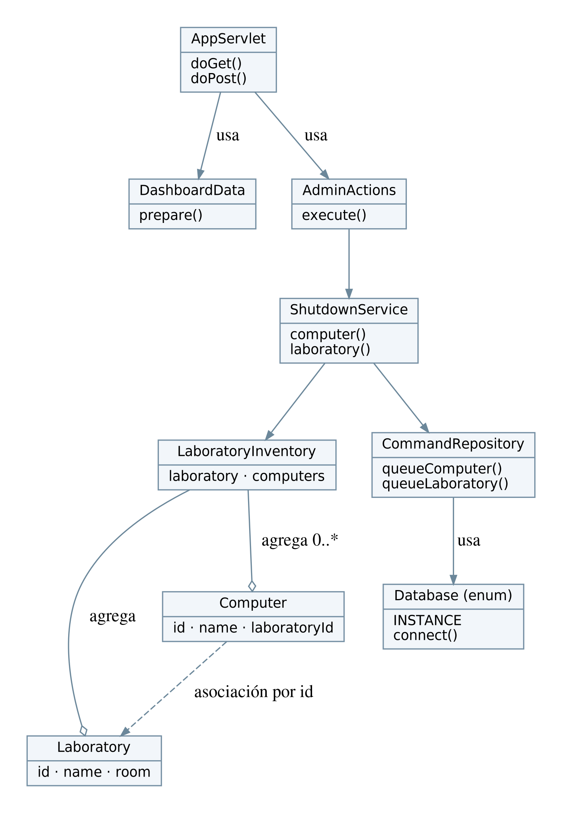
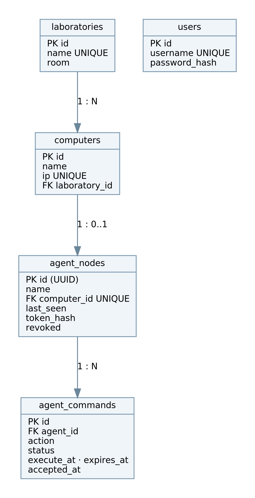
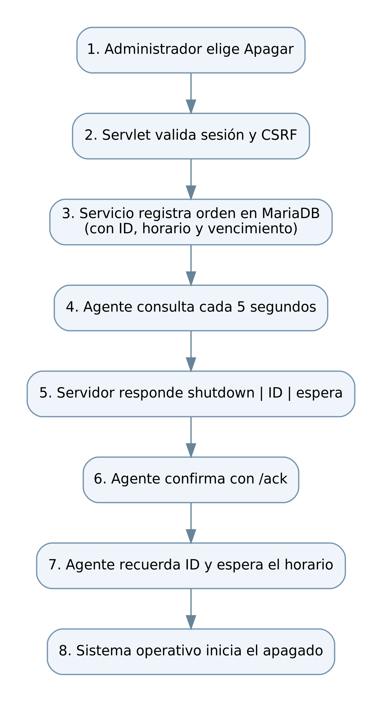
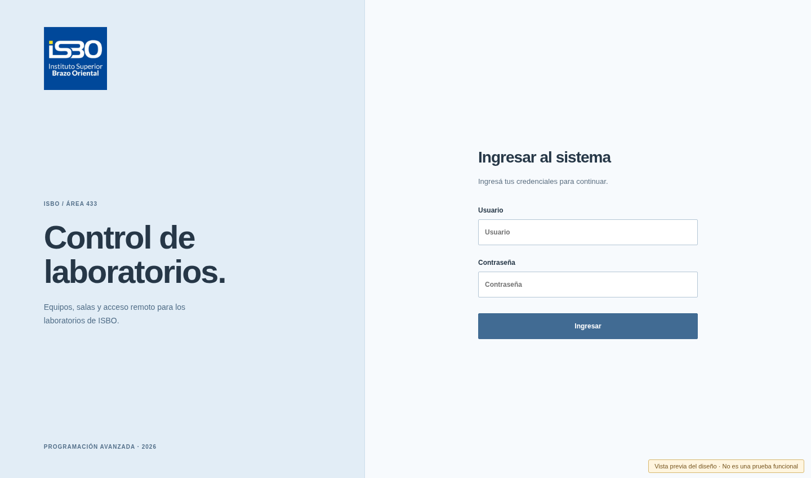
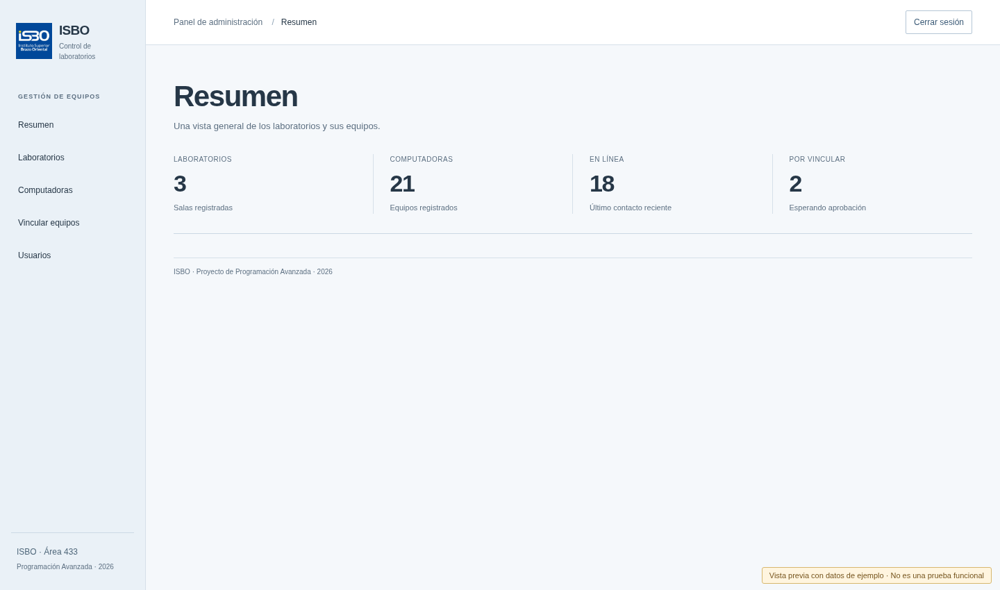
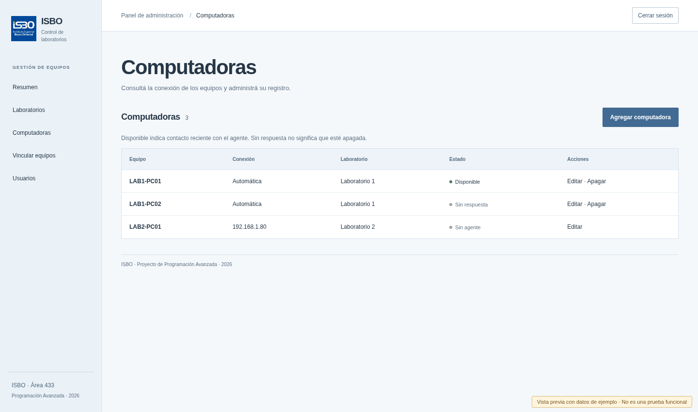

# Sistema web de administración y control de equipos informáticos

**Proyecto de Programación Avanzada · 2026**  
**Instituto Superior Brazo Oriental (ISBO)**  
**Bachillerato Tecnológico · 2.º MJ · Matutino**  
**Integrantes:** Nehuén Climent, Clarisse Taborda y Christian Suarez

## 1. Introducción

En este proyecto hicimos una aplicación web para administrar las computadoras de los laboratorios del ISBO. La pensamos para la Oficina de Control, en el Área 433, porque al terminar las clases pueden quedar computadoras prendidas o sesiones abiertas. La idea es poder revisar los equipos desde un mismo lugar y, si hace falta, pedir que se apaguen sin tener que ir uno por uno.

Además del apagado, nuestra página permite crear y modificar laboratorios, computadoras y usuarios. Trabajamos con Java, JSP, HTML, CSS y MariaDB, que son las tecnologías principales de la consigna. El proyecto se puede abrir con NetBeans y usamos Maven para organizar y compilar el código. Para poner en marcha el servidor usamos Docker Compose, que el docente nos autorizó a utilizar como alternativa al entorno de XAMPP.

## 2. Descripción del problema

En una institución con varios laboratorios no siempre es práctico revisar cada computadora a mano. Después de usar una sala, algunas PCs pueden seguir prendidas y gastar energía. También puede quedar abierta la sesión de un estudiante o de un docente, lo que es un problema porque otra persona podría usar esa cuenta.

Necesitábamos una herramienta que juntara la información de las salas y permitiera consultar los equipos y enviar órdenes de apagado. No queríamos depender de conocer la IP de cada computadora para controlarla, ni abrir conexiones de entrada a todos los equipos. Por eso elegimos que un programa pequeño instalado en cada PC se comunique con el servidor.

## 3. Objetivos

### Objetivo general

Desarrollar una aplicación web cliente-servidor con la que podamos administrar y controlar computadoras de los laboratorios del instituto desde un panel central.

### Objetivos específicos

- Registrar, consultar, editar y eliminar laboratorios.
- Registrar computadoras y asignarlas a un laboratorio.
- Administrar las cuentas de quienes pueden ingresar al sistema.
- Guardar la información en MariaDB, para que no se pierda al cerrar la página.
- Mostrar si las computadoras se comunicaron recientemente con el servidor.
- Solicitar el apagado individual de una computadora.
- Solicitar el apagado de los equipos de un laboratorio de forma coordinada.
- Aplicar asociación, agregación, Singleton y colecciones en Java.
- Tener una interfaz clara y una instalación que podamos repetir.

## 4. Análisis y solución que elegimos

Dividimos el sistema en dos programas. El **servidor** recibe las solicitudes del navegador, muestra las páginas JSP y guarda los datos en MariaDB. El **agente** es una aplicación Java que instalamos en cada computadora que queramos controlar.

El agente se conecta al servidor cada cinco segundos por HTTPS. En esa consulta informa que sigue funcionando y pregunta si hay una orden. Si todavía no lo aprobamos desde el panel, queda como pendiente y no recibe apagados. Esto permite revisar a qué laboratorio pertenece antes de incorporarlo.

Si pedimos apagar una computadora, el servidor registra una orden identificada y con un tiempo de ejecución. El agente la recibe, confirma que la aceptó y después le solicita al sistema operativo que se apague. Para toda una sala, las órdenes llevan el mismo momento previsto, así que los equipos pueden empezar el proceso casi juntos. No podemos garantizar que todos terminen de apagarse exactamente al mismo segundo.

### Cómo usamos la aplicación

El menú del panel tiene **Resumen, Laboratorios, Computadoras, Vincular equipos y Usuarios**. En las tablas podemos consultar la información, y con los formularios agregamos o modificamos registros. El resumen nos muestra cantidades. En Computadoras diferenciamos tres situaciones: **Disponible** (el agente se comunicó hace poco), **Sin respuesta** (no tenemos contacto reciente) y **Sin agente** (se cargó como registro manual). Sin respuesta no significa necesariamente apagada.

### Instalación

El servidor se ejecuta con Docker Compose, que inicia MariaDB, Tomcat y Caddy. GitHub Actions compila el proyecto cuando publicamos una versión y deja un ZIP del servidor y paquetes de agente para cada plataforma en Releases.

Para las computadoras usamos GraalVM Native Image, que convierte nuestro agente Java en un ejecutable del sistema operativo. De esa manera no precisamos instalar Java en cada PC. El instalador configura el arranque automático y guarda una identidad individual; cuando actualizamos, esa identidad se conserva.

## 5. Arquitectura cliente-servidor

Desde el navegador nos conectamos por HTTPS a Caddy. Caddy recibe la conexión y se la pasa a Tomcat, que ejecuta nuestra aplicación Java y las JSP. Tomcat es el único componente que consulta MariaDB. Los agentes también se conectan a Caddy por HTTPS, pero lo hacen ellos: no abrimos puertos de entrada en las computadoras del laboratorio.

Por dentro separamos el servidor en partes con tareas distintas. **Los servlets** reciben las solicitudes de la web; **los servicios** aplican las validaciones y reglas; **los repositorios** ejecutan las consultas SQL; y **los modelos** representan los datos. Así podemos encontrar dónde modificar una cosa sin revisar todo el programa.

Elegimos HTTPS para no enviar las credenciales sin protección por la red. Caddy genera certificados con una autoridad local. Su certificado público se copia a los agentes durante la instalación, mientras que las claves privadas permanecen en el servidor. Cada computadora también tiene un token propio; la base guarda su hash, no el token original.

## 6. Diseño orientado a objetos

No quisimos agregar clases solamente para que el UML pareciera más grande. Tratamos de usar los conceptos de POO de una forma que tuviera sentido en el programa.

**Asociación.** `AppServlet` mantiene referencias a `DashboardData` y `AdminActions`. Los objetos trabajan juntos para atender la solicitud. También asociamos computadoras con laboratorios por medio de `laboratoryId`.

**Agregación.** `LaboratoryInventory` reúne un objeto `Laboratory` y una colección de objetos `Computer`. Si ese inventario deja de existir, los objetos siguen existiendo por separado. Por eso es una agregación y no una composición.

**Singleton.** `Database` es un `enum` con una sola instancia (`Database.INSTANCE`). Lo usamos como punto de acceso a las conexiones de MariaDB. No significa que haya una única conexión abierta para todas las consultas: cada operación obtiene y cierra la que necesita.

**Colecciones.** Usamos `List` y `ArrayList` para reunir los resultados de las consultas, y `Map` para relacionar el ID de los equipos con sus estados. En el apagado por laboratorio trabajamos con una lista de computadoras.

Además, usamos `record` para las entidades que solo guardan datos, `enum` para el Singleton y métodos con nombres claros para no repetir código. Las consultas a la base se hacen con `PreparedStatement`, que permite pasar parámetros sin armar SQL mezclando texto escrito por el usuario.

## 7. Base de datos

La base se llama `control` y el archivo `database/schema.sql` crea sus tablas al instalar por primera vez:

| Tabla | Para qué la usamos |
|---|---|
| `laboratories` | Nombre y sala de cada laboratorio. |
| `computers` | Nombre, dirección o referencia del agente y laboratorio asignado. |
| `users` | Cuentas autorizadas, con contraseña protegida mediante BCrypt. |
| `agent_nodes` | Identidad de la PC, su último contacto, token protegido y si está aprobada o revocada. |
| `agent_commands` | Órdenes de apagado, su ID, estado, fecha prevista, vencimiento y aceptación. |

Un laboratorio puede tener muchas computadoras; cada una pertenece a un laboratorio. Un equipo puede tener un agente vinculado, y un agente puede recibir varias órdenes a lo largo del tiempo. Usamos claves primarias, claves foráneas y restricciones para evitar datos incoherentes.

Cuando se elimina una computadora vinculada, también se revoca su agente para que no vuelva a aparecer como pendiente con su identidad anterior. Para conservar instalaciones viejas, el servidor también puede agregar las columnas nuevas de las órdenes sin borrar usuarios ni equipos.

## 8. Flujo del apagado remoto

El administrador solicita el apagado desde el panel. Después de revisar su sesión y el token CSRF del formulario, el servidor comprueba si existe un agente disponible y registra la orden. Cada agente consulta al servidor periódicamente. Si hay una orden válida, obtiene su ID y cuánto falta para ejecutarla; luego confirma que la recibió por otro endpoint.

El agente recuerda localmente el ID de la última orden aceptada, para no repetirla tras un reinicio. Si el equipo no responde a tiempo, la orden vence y no debería ejecutarse más tarde por sorpresa. El apagado es normal, sin un comando de ejecución arbitraria enviado desde el navegador.

Hay una diferencia importante: **aceptar una orden no demuestra que el sistema operativo se haya apagado**. Por eso la prueba final se hace sobre computadoras reales, con permiso del instituto, y revisando el resultado en cada una.

## 9. Capturas y presentación de la interfaz

Las siguientes imágenes muestran cómo diseñamos el acceso y el panel, usando los mismos estilos CSS del proyecto y datos de ejemplo. Las incluimos para que se vea la organización de las pantallas; **no son capturas de una prueba funcional con equipos reales**.

Para la demostración en el liceo tenemos que mostrar el servidor funcionando, vincular equipos de prueba y registrar capturas reales de los estados y de los resultados. No incluimos contraseñas ni tokens en esas evidencias.

## 10. Pruebas y seguridad

Preparamos pruebas para compilar los dos módulos Java, validar entradas, revisar la identidad del agente y recorrer las principales operaciones del panel con una base MariaDB de prueba. GitHub Actions ejecuta estas comprobaciones y solo publica paquetes si los trabajos requeridos terminan bien.

Para el uso real también necesitamos que el agente tenga permisos del sistema operativo para apagar su computadora. Los instaladores se ejecutan con autorización administrativa, y la carpeta donde guardan la credencial queda protegida. En la web usamos sesiones, CSRF, protección básica contra intentos repetidos de ingreso y contraseñas guardadas mediante BCrypt.

No implementamos Wake-on-LAN porque aparece como opcional en la consigna. Nos concentramos primero en tener las funciones obligatorias y en que la instalación fuera lo más clara posible.

## 11. Conclusiones

Con el proyecto reunimos el registro de laboratorios, computadoras y usuarios en una misma aplicación. También construimos una forma de consultar si los equipos están disponibles y pedir que se apaguen sin entrar a cada computadora.

La parte que más tuvimos que pensar fue la comunicación con los agentes. Queríamos que funcionara dentro de la red del instituto sin abrir puertos en las PCs y sin instalar Java una por una. Por eso usamos consultas HTTPS periódicas y paquetes nativos. Separar el código en modelos, repositorios, servicios y controladores también nos ayudó a poder explicarlo y modificarlo.

Aprendimos a relacionar los objetos con la base de datos, a trabajar con varias partes de Java y a tomar decisiones de diseño pensando en el uso real. Sabemos que las pruebas de código no sustituyen una demostración física del apagado; esa es la verificación que corresponde hacer con equipos del instituto antes de presentarlo como probado.

## Fuentes utilizadas

- Consigna original del docente: `docs/consigna/requisitos-proyecto.pdf`.
- Documentación oficial de Java y Maven: https://docs.oracle.com/en/java/ y https://maven.apache.org/.
- Documentación de Docker Compose: https://docs.docker.com/compose/.
- Documentación de Caddy: https://caddyserver.com/docs/.
- Documentación de GraalVM Native Image: https://www.graalvm.org/latest/reference-manual/native-image/.
- Código fuente, esquema SQL y pruebas del propio proyecto.
